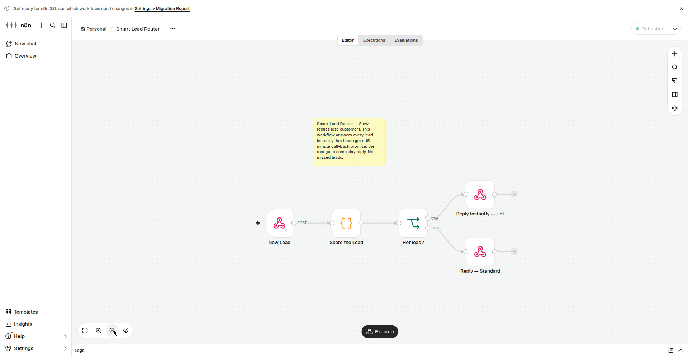

# AI Smart Lead Router

An n8n workflow that answers every lead in seconds — and never lets a hot lead go cold. A lead comes in, the workflow scores it out of 100, and hot leads get an instant call-back promise while everyone else gets a same-day reply.

## The problem

A lead messages your business at 9 PM. Nobody replies until morning. By then, they've already hired someone else.

Slow replies lose customers. Every lead waits while someone checks the inbox — and the urgent ones, the ones ready to buy, wait longest of all.

## How it works

1. **New Lead** — a webhook catches every incoming lead the second it arrives.
2. **Score the Lead** — a Code node scores it out of 100: budget mentioned (+30), urgent words like "urgent", "ASAP", "today" or "need now" (+40), message longer than 20 characters (+15), email provided (+15).
3. **Hot lead?** — if the score is 70 or more, it's hot.
4. **Reply Instantly — Hot** — hot leads get an instant reply: "We'll call you back within 15 minutes."
5. **Reply — Standard** — everyone else gets a same-day reply, so nobody is ignored.

No inbox to check. No hot lead going cold. No lead lost because nobody replied in time.

## Live test results

Tested live on the production webhook — both branches, HTTP 200, answered in seconds.

| Test | Lead | Result |
|------|------|--------|
| Hot | Urgent message with a budget | Score **100** — HOT, instant call-back reply ("we will call you back within 15 minutes") |
| Cold | Short message, no budget, no email | Score **0** — STANDARD, same-day reply |

## Try it

1. Import `smart-lead-router.json` into n8n.
2. No credentials needed — webhook + Code + Respond only.
3. Activate the workflow and POST a JSON lead to `/webhook/lead-router` with `name`, `email`, `message` and `budget`.
4. The score, priority (HOT or STANDARD) and reply come back in the response.

## Limits

- No email or SMS is sent — the reply comes back in the webhook response only.
- Scoring is rule-based (a Code node), not an AI model — it looks for a budget, urgent words, message length and an email address.

## Built with

n8n · JavaScript (Code nodes)

Part of a daily series building one real automation for small businesses, every day.
